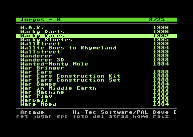
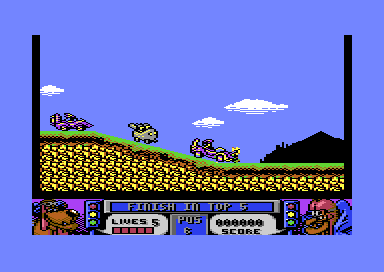
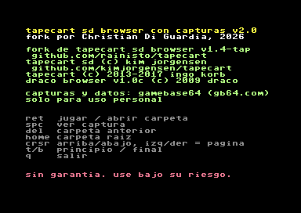

# Tapecart SD Browser con capturas

*[English version](README.en.md)*

Browser para el **Tapecart SD** de la Commodore 64 que muestra el **nombre completo, año, género y editor**
de cada juego y su **captura de pantalla**, directamente en la C64.

Es un **fork de [Tapecart SD Browser v1.4-TAP](https://github.com/rainisto/tapecart/tree/new_tap_with_1.4)**
(Jonni Rainisto, con el soporte de TAP de Jarkko Sonninen), que a su vez deriva de [Tapecart SD](https://github.com/KimJorgensen/tapecart) de Kim Jørgensen,
de [tapecart](https://github.com/ikorb/tapecart) de Ingo Korb y de Draco Browser de Sascha Bader.
Ver [CREDITOS.md](CREDITOS.md).

Fork por **Christian Di Guardia**, 2026.

| Listado | Captura (tecla ESPACIO) | Créditos (tecla `.`) |
|---|---|---|
|  |  |  |

*(Imágenes tomadas en el emulador VICE.)*

## Qué agrega al browser original

- En carpetas con `index.db`: nombre completo (hasta 30 caracteres, el firmware solo muestra 16), año, género y editor.
- En carpetas con `shots.db`: **ESPACIO** muestra la captura del juego (bitmap hires o multicolor). RETURN desde la captura carga el juego.
- Carpetas sin índice: funciona como el original, pero **ordena alfabéticamente** (el original muestra el orden físico de la SD).
- Oculta carpetas de sistema (`System Volume Information`, `$RECYCLE.BIN`, archivos de macOS).
- Carga PRG, TCRT y TAP igual que el original. **No hace falta cambiar el firmware.**

## Requisitos

- Tapecart SD con firmware **v1.4-TAP** ([rainisto/tapecart, rama `new_tap_with_1.4`](https://github.com/rainisto/tapecart/tree/new_tap_with_1.4)).
  Debería andar también con el firmware v1.4 de Kim Jørgensen, salvo la carga de TAP. *Sin probar.*
- Para compilar: [cc65](https://cc65.github.io).
- Para generar índices y capturas: Python 3, tu propia copia de [GameBase64](https://www.gb64.com) y,
  para exportar su base, Windows con el driver ODBC de Access y [innoextract](https://constexpr.org/innoextract/).

## Instalación

1. Hacé una copia de tu `browser.prg` original.
2. Copiá `bin/browser.prg` a la raíz de la SD. El firmware siempre carga `/browser.prg`.
3. Sin índices, ya funciona: listado ordenado alfabéticamente.

## Generar índices y capturas para tu colección

Los datos y capturas de GameBase64 son **solo para uso personal** (ver *Licencias*). Por eso este proyecto
no incluye ningún índice: cada usuario los genera con su propia copia.

1. Bajá de [gb64.com/downloads.php](https://www.gb64.com/downloads.php) la *GB64 Database* y las *GB64 Screenshots*.
2. Extraé `GBC_vXX.mdb` del instalador sin ejecutarlo:
   `innoextract -I GBC_v19.mdb gb64v19.exe`
3. Exportá la base a CSV:
   `powershell -File tools\export_gb64.ps1 -Mdb app\GBC_v19.mdb -Out games.csv`
4. Armá el catálogo de tu SD (por ejemplo `E:\`):
   `python -I tools\build_catalog.py E:\ games.csv catalog.json`
   - Si tus archivos tienen nombres cortos, podés indicar el título real en `E:\titulos.csv`
     (líneas `carpeta/archivo;Título`).
5. Generá los índices y capturas:
   `python -I tools\gen_db.py E:\ catalog.json Screenshots out`
6. Copiá cada `out\<carpeta>\index.db` y `shots.db` a la misma carpeta de la SD.

Consejos:
- **Nombres de 16 caracteres como máximo** (extensión incluida). Los más largos el firmware los muestra en formato 8.3 (`LASTNI~1.TAP`).
- Si agregás juegos a una carpeta con índice, el browser lo detecta y muestra el listado normal hasta que regeneres el índice.
- El firmware **no carga D64/G64/T64**.

## Teclas

| Tecla | Acción |
|---|---|
| RETURN / disparo | jugar / abrir carpeta |
| ESPACIO | ver captura |
| DEL | carpeta anterior |
| HOME | carpeta raíz |
| Cursor ↑↓ | mover |
| Cursor ←→ | página anterior / siguiente |
| T / B | principio / final |
| `.` | créditos y ayuda |
| Q | salir |

## Compilar

```
build.bat      (Windows)
./build.sh     (Linux / macOS)
```

El browser se puede probar en VICE con `browser/mock_tapecartif.c`, que simula el tapecart leyendo
`dirlist`, `index.db` y `shots.db` desde una carpeta del PC montada como unidad 8.

## Estado

- Probado en VICE (listado, capturas, orden y créditos) y en uso en una C128 en modo 64 con Tapecart SD.
- Formato de los archivos: [docs/FORMATO.md](docs/FORMATO.md).

## Licencias

- **Código derivado de Draco Browser:** se puede usar libremente conservando el aviso del origen y del autor.
- **Código derivado de tapecart (Ingo Korb):** licencia BSD de 2 cláusulas, conservada en cada archivo.
- **Cambios de este fork:** mismas condiciones, conservando estos avisos.
- **GameBase64:** sus datos y capturas son © GB64 Team, para **uso personal**. Este proyecto **no los incluye ni redistribuye**.
  Las herramientas leen la copia que cada usuario baja de [gb64.com](https://www.gb64.com).
- **Juegos:** este proyecto no incluye ni enlaza juegos.

SIN GARANTÍA. ÚSELO BAJO SU PROPIO RIESGO.
